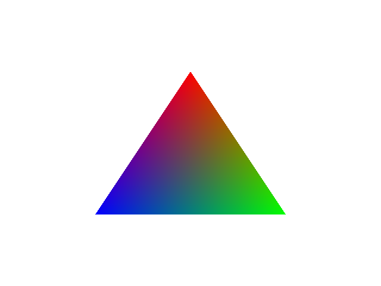

# hello-triangle-github-actions

Example GitHub Actions workflows demonstrating how to set up drivers for Direct3D 11, OpenGL, Metal and Vulkan:

| | **Linux** | **macOS** | **Windows** |
|-|-|-|-|
| **Direct3D 11** | | | [WARP](https://learn.microsoft.com/en-us/windows/win32/direct3darticles/directx-warp) |
| **Metal** | | GPU | |
| **OpenGL** | [Mesa LLVMpipe](https://docs.mesa3d.org/drivers/llvmpipe.html) | `kCGLRendererAppleSWID` | [Mesa LLVMpipe](https://docs.mesa3d.org/drivers/llvmpipe.html) |
| **Vulkan** | [Mesa LLVMpipe](https://docs.mesa3d.org/drivers/llvmpipe.html) | [Mesa LLVMpipe](https://docs.mesa3d.org/drivers/llvmpipe.html) | [Mesa LLVMpipe](https://docs.mesa3d.org/drivers/llvmpipe.html) |

The directories direct3d11, metal, opengl and vulkan each contain a basic "Hello Triangle" application that renders the following tricolored triangle to a PNG image file using their respective rendering APIs.

